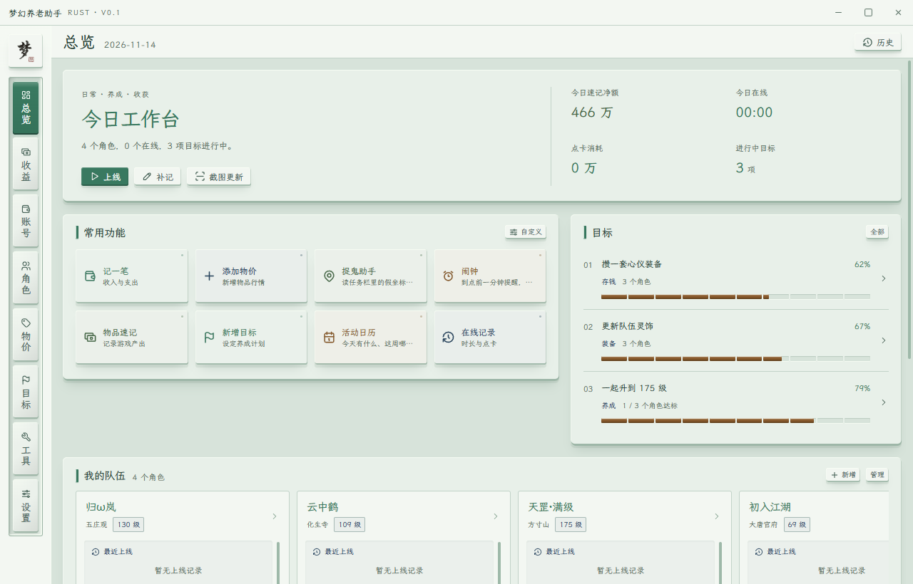
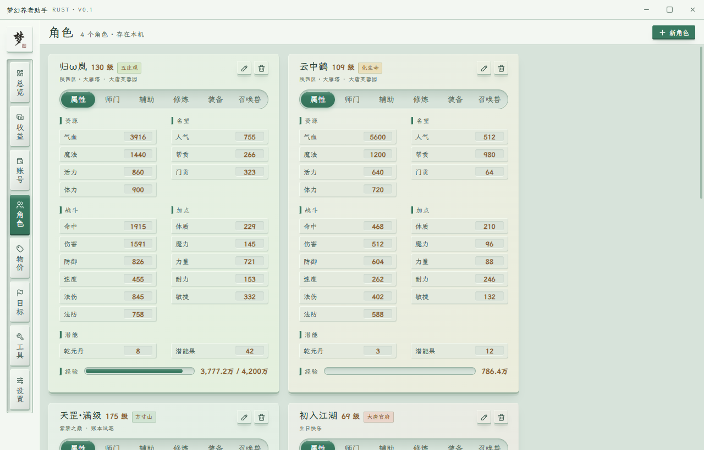
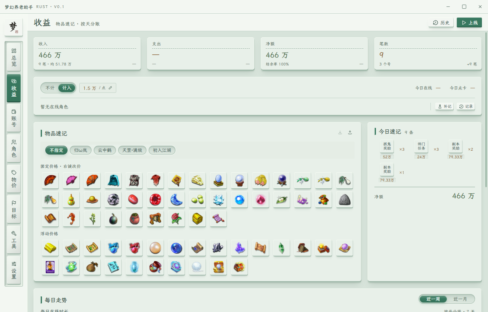

# 梦幻养老助手

梦幻西游端游的日常工作台，集中管理角色养成、游戏收益和账号收支。基于 Rust + Tauri 2 + Vue 3 + SQLite，支持 Windows 10 / 11 x64。

[下载安装](https://github.com/zhijian521/mh-toolbox-rs/releases) · [发布说明](docs/RELEASE.md) · [开发规范](docs/CONVENTIONS.md) · [架构说明](docs/ARCHITECTURE.md)

## 预览

<table>
    <tr>
        <td width="33%" align="center"><a href="docs/screenshots/overview.png"></a><br>总览</td>
        <td width="33%" align="center"><a href="docs/screenshots/characters.png"></a><br>角色</td>
        <td width="33%" align="center"><a href="docs/screenshots/income.png"></a><br>收益</td>
    </tr>
</table>

演示数据，点击图片查看大图。

## 功能

- **角色与目标**：属性、师门、辅助、修炼、装备和召唤兽管理；离线截图识别、成长历史，单角色或多角色养成目标。
- **收益与记账**：物品速记、点卡成本、上线记录、角色分账、物价追踪与统计图表。
- **日常与外观**：自定义快捷入口、捉鬼助手、闹钟、活动日历；六种主题、明暗切换、独立字体与字号设置。

账本保存在本机，支持导入、导出，自动保留最近 14 份日常备份，可在设置页恢复；卸载不删除数据。目录为 `%APPDATA%\mh-tool-rs`；支持通过「导入旧版」单向转换[旧 Electron 版](https://github.com/zhijian521/mh-toolbox) v10 完整备份，新版数据不能回写旧版。设置页支持手动检查正式版本更新。

## 开发

需要 Node.js 22、Rust stable（最低 1.90）、Visual Studio C++ Build Tools 与 Windows SDK，环境配置见 [AGENTS.md](AGENTS.md)。

```bash
npm ci
npm run dev            # 浏览器预览，桌面能力需启动 Tauri
npm run desktop        # Tauri 开发窗口
npm run desktop:build  # Windows 安装包
```

本机也可使用 `start.bat` 补齐编译环境并启动。打包与发布流程见[发布说明](docs/RELEASE.md)，改动记录见 [RECORD.md](docs/RECORD.md)。

## 许可

[PolyForm Noncommercial 1.0.0](LICENSE)，仅限非商业用途。字体许可见[字体说明](assets/fonts/README.md)。本项目为非官方工具，游戏资源与名称的版权归原权利人。
